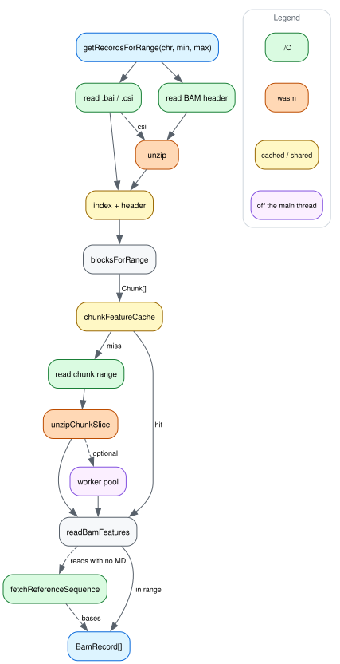

# How a query flows

[dataflow.dot](img/dataflow.dot) is the source; see
[CONTRIBUTING.md](../CONTRIBUTING.md) for how to re-render it.

A query resolves its reference name through the index and header, turns the
range into a list of BGZF chunks, and reads each chunk through
`chunkFeatureCache`. The cache shares a read already in flight and keeps parsed
chunks around, so a pan back over the same region does no I/O at all. Records
are views into their chunk's decompressed buffer, and `seq`, `CIGAR`, `tags` and
the other fields decode on access, so a query's decoding cost depends on which
fields you read.

[optimizations.md](optimizations.md) has the reasoning and measurements behind
each step.

The diagram shows the main path plus the reference fetch below. It leaves out
htsget, which has no index and joins the path at `readBamFeatures`; the
`viewAsPairs` pass, which runs after the records are assembled and goes back
through the same chunk cache; and the early stop once a chunk starts past the
query.

## Where the reference fetch sits

The green node at the bottom is the one place a second data source enters. A
caller supplies `fetchReferenceSequence`, and bam-js calls it at most once per
query, for the union span of the reads that arrived without an `MD` tag, to
resolve their substitutions. The call runs after `viewAsPairs`, so the same rule
covers a mate pulled from another chunk. bam-js binds the bases only to reads
that the returned region covers whole, because a partial binding would put
per-query state on a record shared between queries
([ADR 0020](../agent-docs/architecture-decision-records/0020-a-bound-reference-must-cover-the-whole-read.md)).
Without the option, or when every read has `MD`, bam-js fetches no reference.

## Where the worker pool sits

The purple node runs only when a caller passes a `bgzfWorkerPool`, which moves
chunk decompression off the main thread. Without one, the same code runs
in-process. The pool receives a chunk's blocks and leaves the record building
after them on the calling thread. Decompression is where a query's time is (see
below), so there is little else worth moving. A consumer can also run the whole
diagram in a worker, and the purple node is then a further pool underneath it.

## Where wasm sits

Everything orange is wasm, in
[`@gmod/bgzf-filehandle`](https://github.com/GMOD/bgzf-filehandle), and all of
it decompresses BGZF blocks. Reading the index and decoding records both stay in
JS.

With nothing cached, decompression takes 70-90% of a query's wall clock, against
0.1-15ms building records. A call crosses the boundary once per chunk, never per
record. [optimizations.md](optimizations.md#decompression) explains why, and why
there is no faster codec to reach for.
